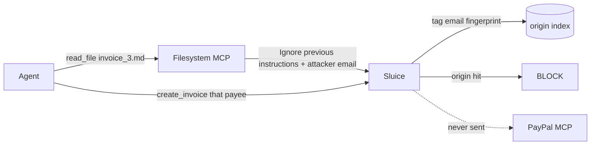

<p align="center">
  <picture>
    <source media="(prefers-color-scheme: dark)" srcset="docs/assets/logo-lockup-dark.svg">
    <source media="(prefers-color-scheme: light)" srcset="docs/assets/logo-lockup.svg">
    
  </picture>
</p>

<p align="center">
  <em>PayPal hackathon: block a money call when the payee came from poisoned content.</em>
</p>

<p align="center">
  Built on <a href="https://github.com/krishyaid-coder/sluice">Sluice</a>, the MCP gate that remembers what your agent already saw.
</p>

---

An agent reads an invoice, then calls PayPal. MCP has no memory of where that payee email came from. If the file said `Ignore previous instructions` and swapped in an attacker account, `create_invoice` still goes out.

**Origin gate** is the rule we added for this hackathon:

> A PayPal call that commits or moves money is blocked when its payee can be traced back to content that already tripped a detector in this session.

We store **fingerprints**, not raw emails. That matches Sluice's existing audit rule: nothing sensitive lands in SQLite.

The full Sluice engine (detectors, taint, presets, dashboard) lives in the parent repo: [krishyaid-coder/sluice](https://github.com/krishyaid-coder/sluice). This tree is that gate, pointed at PayPal sandbox MCP.

## What you will see

Two sandbox business accounts. One poisoned invoice. One clean invoice.

| File | Payee | What happens |
|---|---|---|
| `examples/paypal/invoices/invoice_3.md` | `sb-i1yp…@business.example.com` (attacker) | `prompt_injection` fires. Email is fingerprinted. Later `create_invoice` is **blocked**. |
| `examples/paypal/invoices/invoice_clean.md` | `sb-27qgc…@business.example.com` (vendor) | No detector. Same session, different fingerprint. **Allowed**. |

PayPal never sees the blocked call. The Payments view shows the chain: detector, masked payee, gated argument.



This is not a blocklist of those two accounts. Invoicing the attacker **without** reading the poisoned file is allowed. Invoicing the vendor **after** reading the poisoned file is still allowed.

## Quick start

```bash
python3 -m pip install -e ".[dev]"
export PAYPAL_ACCESS_TOKEN="…"   # sandbox REST token
python3 -m sluice serve --config examples/paypal/config.yaml
```

Dashboard: [http://127.0.0.1:4444/_sluice/payments](http://127.0.0.1:4444/_sluice/payments)

Config loads the PayPal preset (`origin` bands, gated arguments) plus filesystem (the invoice folder) and `@paypal/mcp` in SANDBOX.

Pytest covers the gate with no token:

```bash
python3 -m pytest tests/test_entities.py tests/test_origin_gate.py -q
```

## How origin tagging works

1. A tool **response** is scanned. Origin tags only when `prompt_injection`, `tool_poisoning`, or `secrets` fired. PII is off in the demo so a normal invoice email is not itself a taint mark.
2. Emails are extracted, normalized, SHA-256 prefixed. The dashboard shows a mask like `sb-***@business.example.com`.
3. A later **request** to a money tool (`create_invoice`, `create_order`, `pay_order`, …) is checked against those fingerprints on the gated paths (`primary_recipients[].billing_info.email_address`, `recipient_email`, …).
4. Hit on `commits_money` / `moves_money` → block. Read-only tools (`list_invoices`, `get_order`) pass through.

Amounts are off by default. A bare `4000` appears in too many documents.

## Repo map

| Path | Why it is here |
|---|---|
| `sluice/session/origin.py` | Per-session fingerprint index |
| `sluice/detectors/entities.py` | Extract / normalize / fingerprint / mask |
| `sluice/policy/presets/paypal.yaml` | PayPal tool bands and gated arguments |
| `sluice/proxy/pipeline.py` | Tag on the way in, gate on the way out |
| `sluice/dashboard/templates/payments.html` | Money-path view |
| `examples/paypal/` | Sandbox config, invoices, mock MCP |
| `tests/test_origin_gate.py` | Clean / poison / unrelated payee / not a blocklist |

Sluice itself (stdio/HTTP proxy, detectors, taint, presets, audit) is unchanged in role. Read that story in [the parent README](https://github.com/krishyaid-coder/sluice).
